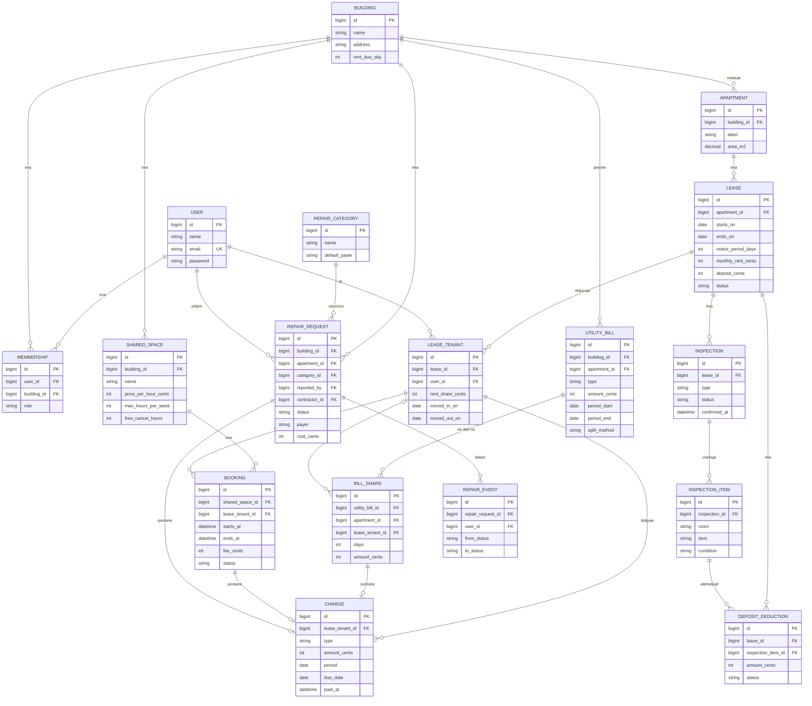

# 03 – Podatkovni model

Rešitev uporablja relacijsko podatkovno bazo PostgreSQL. Podatki so močno povezani in finančni, zato model temelji na tujih ključih, omejitvah in transakcijah.

Model obsega 18 podrobno opisanih entitet in 6 dodatnih entitet, ki so na koncu dokumenta opisane na kratko. Imena tabel in polj so v angleščini, ker se bodo tako uporabljala v kodi.

## Pregled entitet

| Sklop | Entitete |
| --- | --- |
| Uporabniki in stavba | User, Building, Membership, Apartment |
| Najem | Lease, LeaseTenant |
| Denar | Charge, UtilityBill, BillShare |
| Skupni prostori | SharedSpace, Booking |
| Primopredaja in varščina | Inspection, InspectionItem, DepositDeduction |
| Okvare | RepairCategory, RepairRequest, RepairEvent |
| Datoteke | Attachment |

## Entitete in glavna polja

### User – uporabnik

| Polje | Tip | Opis |
| --- | --- | --- |
| id | bigint, PK | |
| name | varchar | Ime in priimek ali naziv podjetja |
| email | varchar, unique | Uporablja se za prijavo |
| phone | varchar, nullable | |
| password | varchar | Zgoščena vrednost gesla |

### Building – stavba

| Polje | Tip | Opis |
| --- | --- | --- |
| id | bigint, PK | |
| name | varchar | |
| address | varchar | |
| rent_due_day | smallint | Dan v mesecu, do katerega je treba plačati obveznosti |

### Membership – članstvo v stavbi

Povezuje uporabnika s stavbo in določa njegovo vlogo.

| Polje | Tip | Opis |
| --- | --- | --- |
| id | bigint, PK | |
| user_id | FK → User | |
| building_id | FK → Building | |
| role | enum | `landlord`, `tenant`, `contractor` |

### Apartment – stanovanje

| Polje | Tip | Opis |
| --- | --- | --- |
| id | bigint, PK | |
| building_id | FK → Building | |
| label | varchar | Oznaka stanovanja, na primer »2B« |
| floor | smallint | |
| area_m2 | numeric(6,2) | Površina, uporablja se pri delitvi položnic |
| rooms | smallint | Število sob |

### Lease – najem

| Polje | Tip | Opis |
| --- | --- | --- |
| id | bigint, PK | |
| apartment_id | FK → Apartment | |
| starts_on | date | |
| ends_on | date, nullable | Prazno pri najemu za nedoločen čas |
| notice_period_days | smallint | Odpovedni rok |
| monthly_rent_cents | integer | Najemnina za celo stanovanje |
| deposit_cents | integer | Varščina |
| status | enum | `draft`, `active`, `in_notice`, `ended` |
| notice_given_on | date, nullable | Datum odpovedi |
| terminates_on | date, nullable | Izračunan datum prenehanja |
| deposit_returned_cents | integer, nullable | Izpolni se ob zaključku najema |

### LeaseTenant – najemnik na najemu

Povezuje najemnike z najemom. V stanovanju z več sostanovalci ima vsak svoj zapis.

| Polje | Tip | Opis |
| --- | --- | --- |
| id | bigint, PK | |
| lease_id | FK → Lease | |
| user_id | FK → User | |
| rent_share_cents | integer | Del najemnine, ki ga plačuje ta najemnik |
| moved_in_on | date | |
| moved_out_on | date, nullable | Prazno, dokler najemnik živi v stanovanju |

### Charge – obveznost

Vsak znesek, ki ga najemnik dolguje lastniku.

| Polje | Tip | Opis |
| --- | --- | --- |
| id | bigint, PK | |
| lease_tenant_id | FK → LeaseTenant | |
| type | enum | `rent`, `utility`, `booking`, `repair`, `other` |
| description | varchar | |
| amount_cents | integer | |
| period | date | Mesec obračuna |
| due_date | date | Rok plačila |
| paid_at | timestamp, nullable | Prazno, dokler obveznost ni plačana |
| bill_share_id | FK → BillShare, nullable | Izpolnjeno pri vrsti `utility` |
| booking_id | FK → Booking, nullable | Izpolnjeno pri vrsti `booking` |
| repair_request_id | FK → RepairRequest, nullable | Izpolnjeno pri vrsti `repair` |

### UtilityBill – položnica

| Polje | Tip | Opis |
| --- | --- | --- |
| id | bigint, PK | |
| building_id | FK → Building | |
| apartment_id | FK → Apartment, nullable | Prazno, če položnica velja za celo stavbo |
| type | enum | `electricity`, `water`, `heating`, `waste`, `internet`, `other` |
| amount_cents | integer | |
| period_start | date | |
| period_end | date | |
| split_method | enum | Delitev med stanovanja: `area`, `persons`, `equal` |

### BillShare – delež položnice

| Polje | Tip | Opis |
| --- | --- | --- |
| id | bigint, PK | |
| utility_bill_id | FK → UtilityBill | |
| apartment_id | FK → Apartment | |
| lease_tenant_id | FK → LeaseTenant, nullable | Prazno pri deležu praznega stanovanja, ki ostane lastniku |
| days | smallint | Število dni bivanja v obdobju položnice |
| amount_cents | integer | |

### SharedSpace – skupni prostor

| Polje | Tip | Opis |
| --- | --- | --- |
| id | bigint, PK | |
| building_id | FK → Building | |
| name | varchar | Na primer »Skupna soba«, »Igralnica«, »Pralnica« |
| price_per_hour_cents | integer | 0 pri brezplačnem prostoru |
| open_from | time | Začetek obratovalnega časa |
| open_to | time | Konec obratovalnega časa |
| max_hours_per_week | smallint | Omejitev na stanovanje |
| free_cancel_hours | smallint | Koliko ur pred terminom je preklic še brezplačen |
| is_active | boolean | |

### Booking – rezervacija

| Polje | Tip | Opis |
| --- | --- | --- |
| id | bigint, PK | |
| shared_space_id | FK → SharedSpace | |
| lease_tenant_id | FK → LeaseTenant | Najemnik, ki je prostor rezerviral |
| starts_at | timestamp | |
| ends_at | timestamp | |
| fee_cents | integer | Cena, izračunana ob rezervaciji |
| status | enum | `confirmed`, `cancelled`, `completed` |
| cancelled_at | timestamp, nullable | |

### Inspection – primopredajni zapisnik

| Polje | Tip | Opis |
| --- | --- | --- |
| id | bigint, PK | |
| lease_id | FK → Lease | |
| type | enum | `move_in`, `move_out` |
| status | enum | `draft`, `confirmed` |
| tenant_remarks | text, nullable | Pripombe najemnika |
| confirmed_by | FK → User, nullable | Najemnik, ki je zapisnik potrdil |
| confirmed_at | timestamp, nullable | |

### InspectionItem – postavka zapisnika

| Polje | Tip | Opis |
| --- | --- | --- |
| id | bigint, PK | |
| inspection_id | FK → Inspection | |
| room | varchar | Na primer »Dnevna soba« |
| item | varchar | Na primer »Stene«, »Tla«, »Omara« |
| condition | enum | `good`, `worn`, `damaged`, `missing` |
| note | text, nullable | |

Postavki vselitvenega in izselitvenega zapisnika se pri primerjavi povežeta po paru (`room`, `item`).

### DepositDeduction – odbitek od varščine

| Polje | Tip | Opis |
| --- | --- | --- |
| id | bigint, PK | |
| lease_id | FK → Lease | |
| inspection_item_id | FK → InspectionItem | Postavka izselitvenega zapisnika, na katero se odbitek nanaša |
| amount_cents | integer | |
| reason | text | |
| status | enum | `proposed`, `accepted`, `disputed`, `withdrawn` |
| tenant_comment | text, nullable | Obrazložitev ugovora |

### RepairCategory – vrsta okvare

| Polje | Tip | Opis |
| --- | --- | --- |
| id | bigint, PK | |
| name | varchar | Na primer »Ogrevanje in topla voda«, »Poškodba po krivdi najemnika« |
| default_payer | enum | `landlord`, `tenant` |

### RepairRequest – prijava okvare

| Polje | Tip | Opis |
| --- | --- | --- |
| id | bigint, PK | |
| building_id | FK → Building | |
| apartment_id | FK → Apartment, nullable | Izpolnjeno, če je okvara v stanovanju |
| shared_space_id | FK → SharedSpace, nullable | Izpolnjeno, če je okvara v skupnem prostoru |
| reported_by | FK → User | |
| category_id | FK → RepairCategory | |
| title | varchar | |
| description | text | |
| status | enum | `reported`, `confirmed`, `rejected`, `assigned`, `scheduled`, `done`, `closed` |
| payer | enum | `landlord`, `tenant`; privzeto iz vrste okvare, lastnik ga lahko spremeni |
| contractor_id | FK → User, nullable | |
| scheduled_at | timestamp, nullable | Termin, ki ga sporoči izvajalec |
| cost_cents | integer, nullable | Strošek, ki ga vpiše izvajalec |

### RepairEvent – dogodek v obravnavi okvare

| Polje | Tip | Opis |
| --- | --- | --- |
| id | bigint, PK | |
| repair_request_id | FK → RepairRequest | |
| user_id | FK → User | Kdo je korak opravil |
| from_status | enum, nullable | |
| to_status | enum | |
| note | text, nullable | |
| created_at | timestamp | |

### Attachment – priloga

Fotografije in dokumenti, vezani na postavko zapisnika ali prijavo okvare.

| Polje | Tip | Opis |
| --- | --- | --- |
| id | bigint, PK | |
| attachable_type | varchar | `InspectionItem` ali `RepairRequest` |
| attachable_id | bigint | |
| uploaded_by | FK → User | |
| path | varchar | Pot do datoteke v shrambi |

## Povezave med entitetami

| Povezava | Vrsta | Pojasnilo |
| --- | --- | --- |
| User – Membership – Building | N : M | Uporabnik ima lahko vloge v več stavbah |
| Building – Apartment | 1 : N | |
| Apartment – Lease | 1 : N | Skozi čas več najemov, hkrati največ en aktiven |
| Lease – LeaseTenant | 1 : N | Več sostanovalcev na istem najemu |
| User – LeaseTenant | 1 : N | |
| LeaseTenant – Charge | 1 : N | Obveznosti posameznega najemnika |
| Building – UtilityBill | 1 : N | |
| UtilityBill – BillShare | 1 : N | En delež za vsakega najemnika ali prazno stanovanje |
| BillShare – Charge | 1 : 0..1 | Delež najemnika postane obveznost |
| Building – SharedSpace | 1 : N | |
| SharedSpace – Booking | 1 : N | |
| LeaseTenant – Booking | 1 : N | |
| Booking – Charge | 1 : 0..1 | Plačljiva rezervacija postane obveznost |
| Lease – Inspection | 1 : N | Največ dva: vselitveni in izselitveni |
| Inspection – InspectionItem | 1 : N | |
| Lease – DepositDeduction | 1 : N | |
| InspectionItem – DepositDeduction | 1 : N | Odbitek je vezan na postavko izselitvenega zapisnika |
| Building – RepairRequest | 1 : N | |
| RepairCategory – RepairRequest | 1 : N | |
| RepairRequest – RepairEvent | 1 : N | Vsak prehod stanja je en dogodek |
| RepairRequest – Charge | 1 : 0..1 | Popravilo v breme najemnika postane obveznost |

## Osnutek podatkovnega modela

Entiteta `Attachment` v diagramu ni prikazana, ker se z isto tabelo veže na več entitet (postavke zapisnika in prijave okvar).

## Pravila za celovitost podatkov

- **Denar v centih.** Vsi zneski so shranjeni kot cela števila v centih, zato pri seštevanju ni zaokrožitvenih napak.
- **En aktiven najem na stanovanje.** Delni enolični indeks na `apartment_id` za najeme v stanju `active` ali `in_notice`.
- **Brez prekrivanja rezervacij.** Izključitvena omejitev (exclusion constraint) na ravni baze prepreči dve nepreklicani rezervaciji istega prostora s prekrivajočim se časom, tudi če zahtevi prispeta hkrati.
- **Največ dva zapisnika na najem.** Enolični indeks na (`lease_id`, `type`).
- **Primerljive postavke.** Enolični indeks na (`inspection_id`, `room`, `item`), da se postavki obeh zapisnikov lahko povežeta.
- **Potrjen zapisnik je zaklenjen.** Postavk zapisnika v stanju `confirmed` ni mogoče spreminjati.
- **Vsota deležev je enaka položnici.** Vsota `amount_cents` v `BillShare` je enaka znesku položnice. Položnica, deleži in obveznosti se shranijo v eni transakciji.
- **Deleži najemnine.** Vsota `rent_share_cents` aktivnih najemnikov je enaka `monthly_rent_cents` najema.
- **Varščina se ne more prekoračiti.** Vsota odbitkov, ki niso umaknjeni, ne sme preseči `deposit_cents`.
- **Brez brisanja finančnih zapisov.** Izdane obveznosti se ne brišejo in ne spreminjajo, popravek je nov zapis.

## Obseg prve različice in dodatne entitete

Prva delujoča različica uporablja 15 od 18 zgoraj opisanih entitet ter entiteti `Announcement` in `AnnouncementRead` iz spodnje tabele. Entitete `Inspection`, `InspectionItem` in `DepositDeduction` bodo dodane skupaj s primopredajnim zapisnikom in obračunom varščine.

Spodnje entitete se vežejo na obstoječe stavbe, stanovanja in najeme, zato obstoječega modela ne spreminjajo.

| Entiteta | Glavna polja | Funkcionalnost |
| --- | --- | --- |
| Announcement | building_id, author_id, title, body, floor, published_at | Novice in obvestila (MVP) |
| AnnouncementRead | announcement_id, user_id, read_at | Potrditev branja (MVP) |
| MeterReading | apartment_id, meter_type, value, reading_date, entered_by, is_flagged | Popisi števcev in poraba |
| InventoryItem | lease_id, name, quantity, handed_over_on, returned_on | Inventar in ključi |
| RentChange | lease_id, new_rent_cents, effective_from, announced_at | Sprememba najemnine |
| Document | apartment_id, title, path, uploaded_by | Dokumenti stanovanja |
