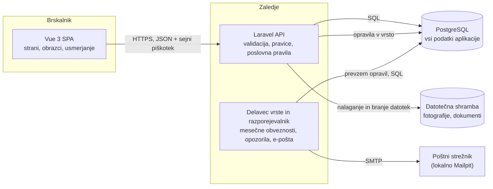

# 04 – Arhitektura in tehnološki sklad

## Arhitektura

BlockBoard je sestavljen iz treh glavnih delov: enostranske spletne aplikacije (SPA) v brskalniku, zalednega dela z vmesnikom REST API in relacijske podatkovne baze.

### Diagram



### Glavni deli sistema

| Del | Naloga |
| --- | --- |
| **Vue SPA** | Prikazuje strani in obrazce glede na vlogo uporabnika. Ne vsebuje poslovnih pravil, prikazuje to, kar vrne API. |
| **Laravel API** | Preveri vhodne podatke in pravice uporabnika, izvede poslovno logiko in vrne odgovor v obliki JSON. |
| **Delavec vrste in razporejevalnik** | Ista koda Laravel v ločenem procesu. Vsak mesec ustvari obveznosti za najemnino, opozarja na iztek najemov in zamude, zaključuje pretekle rezervacije in pošilja e-pošto. |
| **PostgreSQL** | Edini vir resnice. Poleg podatkov aplikacije hrani tudi seje in vrsto opravil, zato dodatna shramba ni potrebna. |
| **Datotečna shramba** | Fotografije iz zapisnikov in prijav okvar. Datoteke so dostopne samo prek API-ja, po preverjanju pravic. |

Poslovna logika je v zalednem delu razdeljena na storitvene razrede:

- `LeaseLifecycle` – dovoljeni prehodi med stanji najema in izračun datuma prenehanja,
- `ChargeGenerator` – mesečno ustvarjanje obveznosti,
- `BillSplitter` – delitev položnice med stanovanja in sostanovalce z razporeditvijo ostanka centov,
- `BookingService` – preverjanje obratovalnega časa in tedenske omejitve, izračun cene, pravilo preklica,
- `InspectionComparer` – primerjava vselitvenega in izselitvenega zapisnika,
- `DepositSettlement` – odbitki, ugovori in izračun vračila varščine,
- `RepairWorkflow` – dovoljeni prehodi med stanji prijave okvare in določitev plačnika.

### Komunikacija med deli sistema

- **SPA ↔ API:** protokol HTTPS, podatki v obliki JSON, vmesnik po načelih REST. Brskalnik nikoli ne dostopa neposredno do baze ali datotek.
- **Koraki delovnih procesov** so ločene končne točke in ne splošno urejanje zapisa, na primer `POST /api/leases/{id}/give-notice` ali `POST /api/inspections/{id}/confirm`. Tako neveljaven korak ni mogoč.
- **Odgovori o napakah:** `422` za neveljavne podatke (s sporočilom za vsako polje), `403` za dejanje brez pravice, `409` za neveljaven korak v procesu ali zaseden termin.
- **API ↔ baza:** Eloquent ORM. Operacije, ki spreminjajo več finančnih zapisov hkrati, se izvedejo v eni transakciji.
- **API → delavec:** opravila se zapišejo v tabelo `jobs`, delavec jih prevzame in izvede v ozadju.

Primeri končnih točk:

| Metoda in pot | Vloga | Namen |
| --- | --- | --- |
| `GET /api/me` | prijavljen | Uporabnik z njegovimi stavbami in vlogami |
| `POST /api/apartments/{id}/leases` | lastnik | Nov najem v stanju osnutek |
| `POST /api/leases/{id}/give-notice` | lastnik, najemnik | Odpoved najema, izračun datuma prenehanja |
| `POST /api/leases/{id}/inspections` | lastnik | Priprava vselitvenega ali izselitvenega zapisnika |
| `POST /api/inspections/{id}/confirm` | najemnik | Potrditev zapisnika |
| `GET /api/leases/{id}/inspection-diff` | lastnik, najemnik | Razlike med zapisnikoma |
| `POST /api/leases/{id}/deductions` | lastnik | Predlog odbitka od varščine |
| `POST /api/deductions/{id}/dispute` | najemnik | Ugovor na odbitek |
| `POST /api/buildings/{id}/utility-bills` | lastnik | Vnos položnice in izračun deležev |
| `GET /api/me/charges` | najemnik | Lastne obveznosti |
| `POST /api/charges/{id}/mark-paid` | lastnik | Označitev plačila |
| `GET /api/shared-spaces/{id}/availability` | najemnik | Prosti termini |
| `POST /api/shared-spaces/{id}/bookings` | najemnik | Rezervacija termina |
| `POST /api/buildings/{id}/repair-requests` | najemnik, lastnik | Prijava okvare |
| `POST /api/repair-requests/{id}/assign` | lastnik | Določitev izvajalca in plačnika |
| `POST /api/repair-requests/{id}/complete` | izvajalec | Poročilo o izvedbi |

### Podatkovna baza

Uporabljena je relacijska baza **PostgreSQL**. Shemo določajo migracije Laravel, začetne podatke pa razredi za polnjenje (seeders). Podatkovni model je opisan v dokumentu `03-podatkovni-model.md`.

Baza sama zagotavlja del pravil: tuje ključe, delni enolični indeks za en aktiven najem na stanovanje in izključitveno omejitev, ki preprečuje prekrivanje rezervacij.

### Avtentikacija in upravljanje uporabnikov

**Avtentikacija** poteka s sejnimi piškotki prek paketa Laravel Sanctum:

1. SPA od strežnika zahteva piškotek CSRF.
2. Uporabnik pošlje e-naslov in geslo.
3. Strežnik preveri geslo (zgoščeno z algoritmom bcrypt) in nastavi sejni piškotek z oznako `HttpOnly`.
4. SPA pokliče `GET /api/me` in izve, v katerih stavbah ima uporabnik katero vlogo.

V brskalniku se ne shranjuje noben žeton, zato do prijave ne more dostopati skripta na strani.

**Avtorizacija** temelji na članstvu v stavbi in na najemu:

- Vloga (`landlord`, `tenant`, `contractor`) je zapisana v tabeli `Membership` in velja za posamezno stavbo.
- Vsaka končna točka API-ja je za vmesno programsko opremo `auth:sanctum`.
- Za vsak model obstaja razred Policy. Najemnik sme dostopati samo do najemov, na katerih je naveden v `LeaseTenant`, izvajalec samo do prijav okvar, ki so mu dodeljene.
- Poizvedbe so vedno omejene na stavbe uporabnika, zato podatki ene stavbe niso vidni v drugi.
- SPA gumbe in strani skriva glede na vlogo zaradi preglednosti, dejansko preverjanje pa vedno opravi API.

**Upravljanje uporabnikov:**

- Lastnik se registrira sam in ustvari svojo stavbo.
- Najemnika lastnik povabi, ko ga doda na najem. Najemnik prejme e-poštno povabilo s povezavo, na kateri si nastavi geslo.
- Izvajalca lastnik povabi na enak način.
- Javne registracije za najemnike in izvajalce ni, ker mora biti vsak vezan na stavbo.

### Lokalni zagon

Celoten sistem se zažene z orodjem Docker Compose. Razvijalec potrebuje samo Docker.

Struktura repozitorija:

```text
blockboard/
  backend/             Laravel API
  frontend/            Vue SPA
  docs/                dokumentacija
  docker-compose.yml
```

Storitve:

| Storitev | Vsebina | Vrata |
| --- | --- | --- |
| `api` | Laravel na PHP 8.4 | 8000 |
| `worker` | Ista slika, poganja `queue:work` in `schedule:work` | – |
| `db` | PostgreSQL 18 s poimenovanim nosilcem | 5432 |
| `web` | Razvojni strežnik Vite za Vue SPA | 5173 |
| `mail` | Mailpit, lokalni poštni predal | 8025 |

Zagon:

```bash
cp backend/.env.example backend/.env
docker compose up -d
docker compose exec api composer install
docker compose exec api php artisan key:generate
docker compose exec api php artisan migrate --seed
```

Aplikacija je nato dostopna na `http://localhost:5173`. Vite zahteve na `/api`, `/login`, `/logout` in `/sanctum` posreduje storitvi `api`, zato brskalnik vidi en sam izvor in sejni piškotek deluje brez nastavitev CORS.

Začetni podatki ustvarijo eno demo stavbo s stanovanji, skupnimi prostori, vrstami okvar in aktivnim najemom ter po en račun za vsako vlogo, tako da je mogoče delovne procese preizkusiti takoj po zagonu.

## Tehnološki sklad

| Področje | Tehnologija | Namen |
| --- | --- | --- |
| **Frontend** | Vue 3.5, TypeScript | Ogrodje za uporabniški vmesnik |
| | Vite 8 | Razvojni strežnik in gradnja aplikacije |
| | Vue Router 5 | Usmerjanje med stranmi in varovanje poti po vlogah |
| | Pinia | Skupno stanje (prijavljen uporabnik, izbrana stavba) |
| | Tailwind CSS | Oblikovanje |
| | Axios | Klici API-ja s sejnim piškotkom in žetonom CSRF |
| **Backend** | PHP 8.4, Laravel 13 | REST API, validacija, poslovna logika |
| | Eloquent ORM, migracije | Dostop do baze in različice sheme |
| | Laravel Queue (gonilnik `database`) | Opravila v ozadju |
| | Laravel Scheduler | Časovno določena opravila |
| **Podatkovna baza** | PostgreSQL 18 | Shranjevanje vseh podatkov, sej in vrste opravil |
| **Avtentikacija** | Laravel Sanctum (sejni piškotki) | Prijava uporabnikov v SPA |
| | Laravel Policies | Preverjanje pravic po vlogah |
| **Lokalni razvoj** | Docker, Docker Compose | Enako okolje za vse razvijalce |
| | Mailpit | Prestrezanje e-pošte med razvojem |
| | Git | Nadzor različic |
| **Testiranje** | Pest | Testi zalednega dela (delitev položnic, rezervacije, varščina, pravice) |
| | Vitest | Testi komponent in shramb na frontendu |
| **Datoteke** | Laravel Filesystem (lokalni disk) | Fotografije in dokumenti, kasneje shramba, združljiva s S3 |

## Arhitekturne odločitve

Vsaka odločitev iz spodnje tabele je podrobneje opisana kot ADR v direktoriju [adr/](adr/).

| Odločitev | Izbrano | Alternativa | Utemeljitev |
| --- | --- | --- | --- |
| Ločitev frontenda in backenda | Ločena Vue SPA in REST API | Laravel z Inertia.js ali strežniško izrisane strani | Dva jasno ločena dela z dokumentiranim vmesnikom. Isti API lahko kasneje uporablja mobilna aplikacija. Cena je nekaj več začetnega dela. |
| Zaledno ogrodje | Laravel | NestJS, Spring Boot | Validacija, pravice, vrsta opravil in razporejevalnik so že vključeni, zato ni treba sestavljati ločenih paketov. Ogrodje je stabilno in dobro dokumentirano. |
| Podatkovna baza | PostgreSQL | MySQL, MongoDB | Podatki so relacijski in finančni. PostgreSQL poleg transakcij in tujih ključev ponuja izključitvene omejitve nad časovnimi razponi in delne enolične indekse, ki jih rešitev potrebuje. |
| Preprečevanje prekrivanja rezervacij | Izključitvena omejitev v bazi | Preverjanje samo v aplikaciji | Preverjanje v aplikaciji odpove, ko dve zahtevi prispeta hkrati. Omejitev v bazi prekrivanje onemogoči v vsakem primeru. |
| Avtentikacija | Sejni piškotek (Sanctum) | Žeton JWT v `localStorage` | Žeton ni dostopen skriptam v brskalniku, odjava pa sejo dejansko konča na strežniku. |
| Mesto vloge | Članstvo v stavbi | Stolpec `role` pri uporabniku | Ista oseba ima lahko v različnih stavbah različne vloge, na primer najemnik v eni in izvajalec v drugi. |
| Zapis denarja | Cela števila v centih | Decimalni tip ali plavajoča vejica | Ni zaokrožitvenih napak, vsota deležev je vedno natanko enaka položnici. |
| Ena tabela obveznosti | `Charge` z vrsto in povezavo na izvor | Ločene tabele za najemnino, stroške in rezervacije | Najemnik ima en mesečni obračun in eno stanje dolga, ne glede na izvor zneska. |
| Najemnik na najemu | Ločena entiteta `LeaseTenant` z datumi | Najemnik kot polje na najemu | Podpira več sostanovalcev in menjavo enega od njih brez novega najema. Datumi omogočajo delitev stroškov po dnevih bivanja. |
| Zapisnik kot postavke | Vrstica za vsak par prostor–predmet | Prosto besedilo ali ena datoteka PDF | Samo strukturirane postavke je mogoče samodejno primerjati med vselitvijo in izselitvijo. |
| Odbitek vezan na postavko | Obvezna povezava na postavko zapisnika | Prost znesek z opisom | Vsak odbitek ima dokaz, najemnik pa natanko ve, čemu ugovarja. |
| Spremembe stanja | Namenske končne točke s preverjanjem prehoda | Splošno urejanje polja `status` | Neveljaven korak ni mogoč, vsak korak ima avtorja in čas. |
| Cena rezervacije | Shranjena ob rezervaciji | Izračun iz trenutnega cenika | Kasnejša sprememba cenika ne spremeni že potrjenih rezervacij. |
| Vrsta opravil | Gonilnik `database` | Redis | Ena storitev manj za zagon. Obremenitev je majhna, zamenjava gonilnika je kasneje stvar nastavitve. |
| Poslovna logika | Storitveni razredi | Logika v krmilnikih | Pravila za delitev položnic in obračun varščine je mogoče testirati ločeno od HTTP-ja. |
| Lokalno okolje | Docker Compose | Ročna namestitev PHP, Node in PostgreSQL | Vsak razvijalec dobi enako okolje z enim ukazom, ne glede na operacijski sistem. |

## Možnosti nadaljnjega razvoja

Arhitektura omogoča širitev brez večjih sprememb:

- **Nove funkcionalnosti** (novice, popisi števcev, inventar, dokumenti) so novi moduli z lastnimi tabelami, ki uporabljajo obstoječe stavbe, stanovanja in najeme.
- **Nova vloga** (upravljavec v imenu lastnika) pomeni novo vrednost v `Membership.role` in dopolnitev razredov Policy.
- **Mobilna aplikacija** lahko uporablja isti REST API.
- **Samodejno povezovanje plačil** se doda kot uvoz bančnih izpiskov, ki izpolni obstoječe polje `paid_at`.
- **Večja obremenitev:** vrsto opravil je mogoče prestaviti na Redis, datoteke pa v shrambo, združljivo s S3, s spremembo nastavitev.
