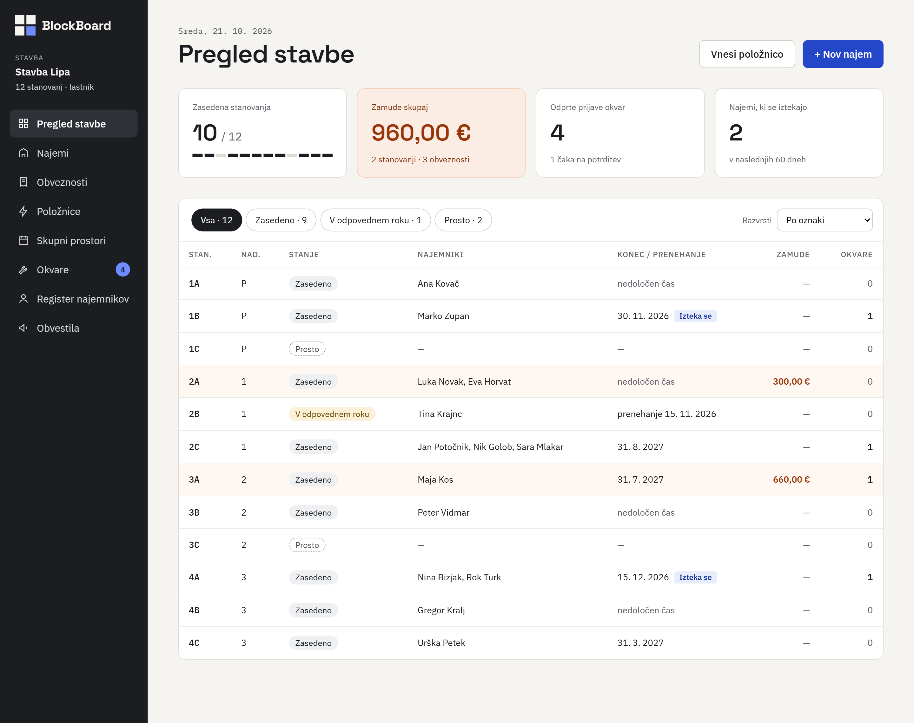
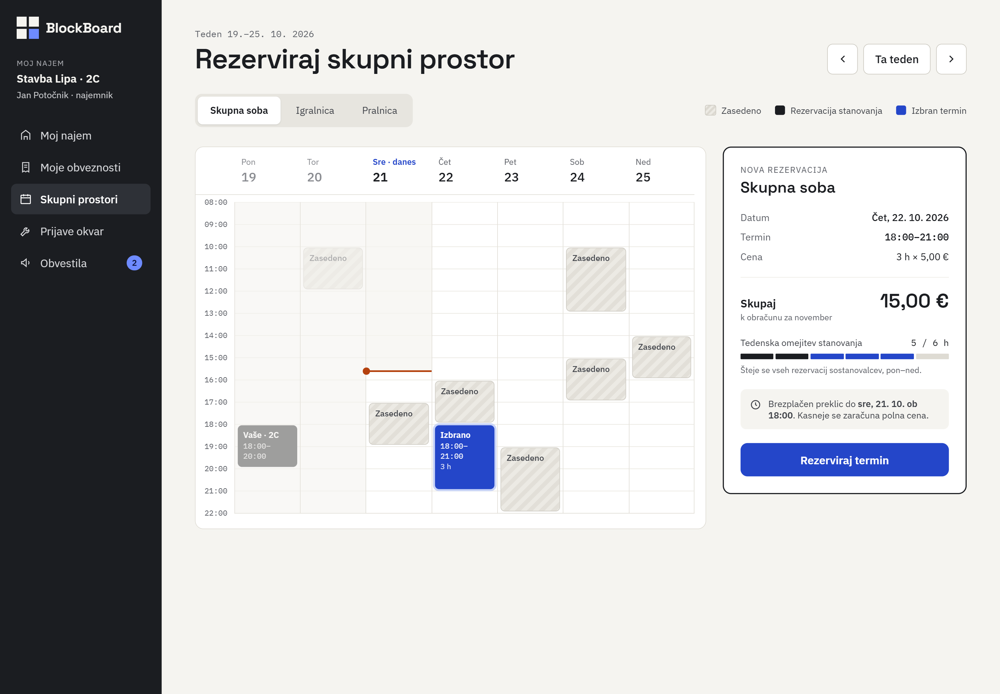
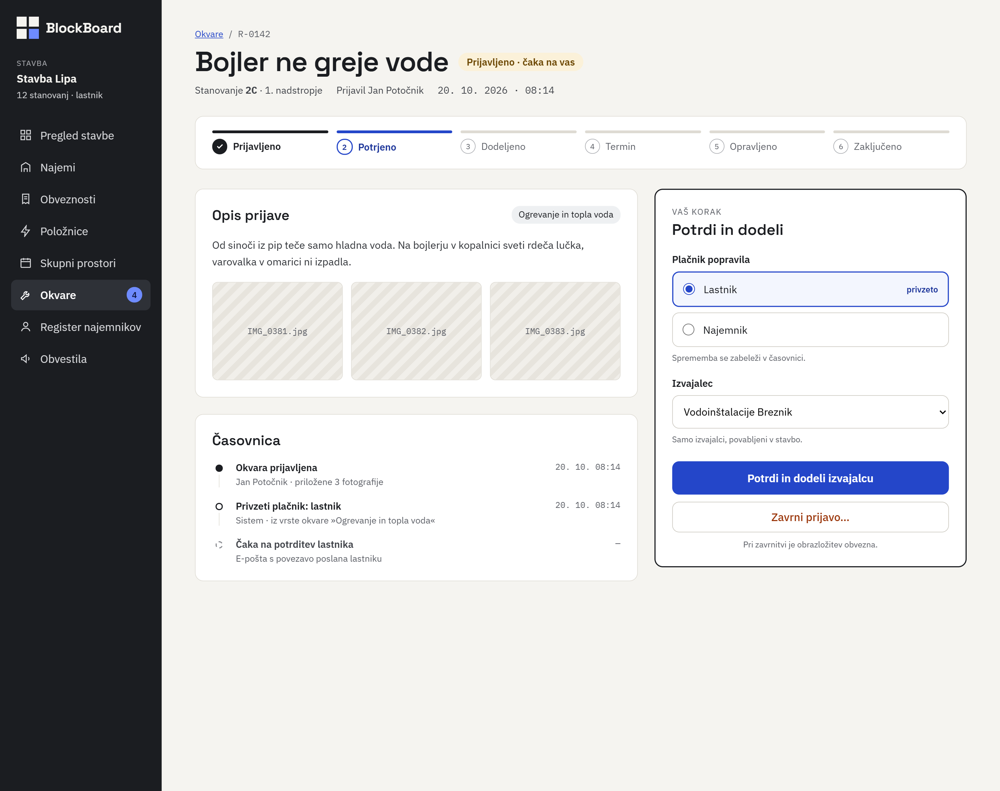
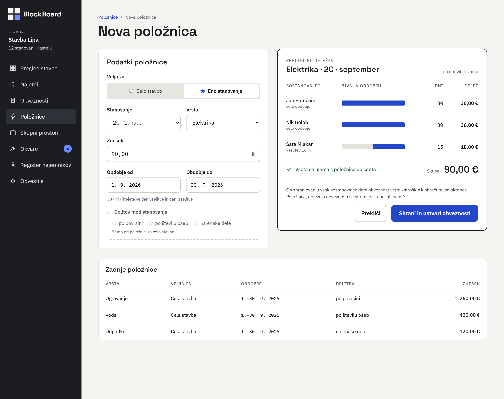

# 06 – Wireframes

## Pregled

| # | Zaslon | Vloga | Funkcionalnost | Uporabniške zgodbe |
| --- | --- | --- | --- | --- |
| 1 | Pregled stavbe | Lastnik stavbe | F8 | US-13 (in US-05) |
| 2 | Rezervacija skupnega prostora | Najemnik | F4 | US-08 |
| 3 | Obravnava prijave okvare | Lastnik stavbe | F7 | US-10 (in US-09) |
| 4 | Nova položnica | Lastnik stavbe | F3 | US-06 (in US-07) |

## Skupna postavitev

Vsi zasloni imajo enako ogrodje:

- **Levi stranski meni** z logotipom, imenom stavbe in vlogo prijavljenega uporabnika (na primer »Stavba Lipa · 12 stanovanj · lastnik« ali »Stavba Lipa · 2C · Jan Potočnik · najemnik«).
- **Meni je odvisen od vloge.** Lastnik vidi postavke Pregled stavbe, Najemi, Obveznosti, Položnice, Skupni prostori, Okvare, Register najemnikov in Obvestila. Najemnik vidi samo Moj najem, Moje obveznosti, Skupni prostori, Prijave okvar in Obvestila.
- **Številka ob postavki** pokaže, koliko stvari čaka na uporabnika: lastnik ima 4 odprte prijave okvar, najemnik 2 neprebrani obvestili.
- **Glavni del** ima naslov strani, po potrebi pot (na primer »Okvare / R-0142«) in glavna dejanja desno zgoraj.

## Wireframe 1 – Pregled stavbe

- **Vloga:** Lastnik stavbe
- **Funkcionalnost:** F8 – Register najemnikov in pregled stavbe
- **Zgodbe:** US-13, deloma US-05 (zamude)

**Namen:** Lastnik na eni strani vidi stanje vseh stanovanj in takoj ugotovi, kje mora ukrepati.

**Kaj prikazuje:**

1. **Glava strani** z današnjim datumom in dvema hitrima dejanjema: »Vnesi položnico« in »+ Nov najem«.
2. **Štiri kartice s povzetkom:**
   - Zasedena stanovanja: 10 / 12, s trakom, ki prikazuje zasedenost posameznih stanovanj.
   - Zamude skupaj: 960,00 € (2 stanovanji, 3 obveznosti). Kartica je obarvana, ker opozarja na težavo.
   - Odprte prijave okvar: 4, od tega 1 čaka na potrditev.
   - Najemi, ki se iztekajo: 2 v naslednjih 60 dneh.
3. **Filtri po stanju:** Vsa (12), Zasedeno (9), V odpovednem roku (1), Prosto (2), ter izbira razvrščanja.
4. **Tabela stanovanj** s stolpci stanovanje, nadstropje, stanje, najemniki, konec ali prenehanje najema, zamude in število odprtih okvar.

**Podrobnosti, ki izhajajo iz zgodb:**

- Stanje stanovanja je prikazano z oznako: »Zasedeno«, »V odpovednem roku« (poudarjeno) ali »Prosto« (črtkano).
- Najema, ki se izteče v 60 dneh (1B in 4A), imata ob datumu oznako »Izteka se«.
- Stanovanji z zamujenimi obveznostmi (2A s 300,00 € in 3A s 660,00 €) sta obarvani, znesek zamude je poudarjen.
- Pri najemu v odpovednem roku je namesto datuma konca prikazan datum prenehanja (2B: »prenehanje 15. 11. 2026«).
- Najem za nedoločen čas ima namesto datuma napis »nedoločen čas«.

## Wireframe 2 – Rezervacija skupnega prostora

- **Vloga:** Najemnik
- **Funkcionalnost:** F4 – Rezervacija skupnih prostorov
- **Zgodbe:** US-08

**Namen:** Najemnik vidi proste termine skupnega prostora in rezervira termin, ne da bi se moral dogovarjati z drugimi.

**Kaj prikazuje:**

1. **Izbira prostora** z zavihki Skupna soba, Igralnica in Pralnica ter **premikanje po tednih** (prejšnji teden, »Ta teden«, naslednji teden).
2. **Tedenski koledar** od ponedeljka do nedelje v obratovalnem času od 8.00 do 22.00. Današnji dan je označen, rdeča črta kaže trenutni čas.
3. **Legenda** s tremi vrstami terminov:
   - »Zasedeno« (črtkano): rezervacije drugih najemnikov, brez njihovih imen.
   - »Rezervacija stanovanja« (temno): rezervacija sostanovalca iz istega stanovanja, na primer »Vaše · 2C, 18:00–20:00« v ponedeljek.
   - »Izbran termin« (modro): termin, ki ga najemnik pravkar izbira.
4. **Plošča »Nova rezervacija«** na desni strani s povzetkom izbranega termina:
   - prostor, datum (čet, 22. 10. 2026) in termin (18:00–21:00),
   - cena: 3 h × 5,00 € = **15,00 €**, z opombo »k obračunu za november«,
   - tedenska omejitev stanovanja: **5 / 6 h**, z opombo, da se štejejo rezervacije vseh sostanovalcev od ponedeljka do nedelje,
   - pravilo preklica: brezplačen preklic do sre, 21. 10. ob 18.00, kasneje se zaračuna polna cena,
   - gumb »Rezerviraj termin«.

**Podrobnosti, ki izhajajo iz zgodb:**

- Cena se zaračuna v obračunu meseca po terminu: oktobrski termin gre v novembrski obračun (US-08).
- Tedenska omejitev sešteje 2 uri ponedeljkove rezervacije sostanovalca in 3 ure izbranega termina (US-08).
- Meja za brezplačen preklic je določena v pravilih prostora, tukaj 24 ur pred začetkom termina.

## Wireframe 3 – Obravnava prijave okvare

- **Vloga:** Lastnik stavbe
- **Funkcionalnost:** F7 – Prijave okvar s pravilom plačnika
- **Zgodbe:** US-10, deloma US-09 (podatki prijave)

**Namen:** Lastnik pregleda novo prijavo okvare, določi plačnika in izvajalca ali prijavo zavrne.

**Kaj prikazuje:**

1. **Glava prijave:** številka R-0142, naslov »Bojler ne greje vode«, stanje »Prijavljeno · čaka na vas«, lokacija (stanovanje 2C, 1. nadstropje), prijavitelj (Jan Potočnik) ter datum in čas prijave.
2. **Potek obravnave v šestih korakih:** Prijavljeno, Potrjeno, Dodeljeno, Termin, Opravljeno in Zaključeno. Opravljeni koraki so označeni s kljukico, naslednji korak je poudarjen.
3. **Opis prijave** z vrsto okvare (»Ogrevanje in topla voda«), besedilom najemnika in tremi priloženimi fotografijami.
4. **Časovnica** vseh korakov z avtorjem in časom:
   - Okvara prijavljena (Jan Potočnik, priložene 3 fotografije),
   - Privzeti plačnik: lastnik (sistem, iz vrste okvare),
   - Čaka na potrditev lastnika (e-pošta s povezavo poslana lastniku).
5. **Plošča »Vaš korak – Potrdi in dodeli«** na desni strani:
   - izbira plačnika popravila: Lastnik (označen kot privzeto) ali Najemnik, z opombo, da se sprememba zabeleži v časovnici,
   - izbira izvajalca (na primer »Vodoinštalacije Breznik«), z opombo, da so na voljo samo izvajalci, povabljeni v stavbo,
   - gumb »Potrdi in dodeli izvajalcu«,
   - gumb »Zavrni prijavo…« z opombo, da je pri zavrnitvi obrazložitev obvezna.

**Podrobnosti, ki izhajajo iz zgodb:**

- Privzeti plačnik izhaja iz vrste okvare, lastnik pa ga lahko spremeni (US-09, US-10).
- Potrditev in dodelitev izvajalca sta združeni v en gumb, zato lastnik prijavo obravnava v enem koraku.

## Wireframe 4 – Nova položnica

- **Vloga:** Lastnik stavbe
- **Funkcionalnost:** F3 – Delitev položnic
- **Zgodbe:** US-06, deloma US-07 (delitev za celo stavbo)

**Namen:** Lastnik vnese položnico, pred shranjevanjem vidi, koliko bo plačal vsak sostanovalec, in nato z enim klikom ustvari obveznosti.

**Kaj prikazuje:**

1. **Obrazec »Podatki položnice«:**
   - »Velja za«: Celo stavbo ali Eno stanovanje,
   - stanovanje (2C · 1. nad.) in vrsta (Elektrika),
   - znesek (90,00 €),
   - obdobje od 1. 9. 2026 do 30. 9. 2026, z izračunom »30 dni · štejeta se dan vselitve in dan izselitve«,
   - delitev med stanovanja (po površini, po številu oseb, na enake dele). Pri položnici za eno stanovanje je ta del onemogočen, z opombo »Samo pri položnici za celo stavbo«.
2. **Predogled deležev** na desni strani za »Elektrika · 2C · september« po dnevih bivanja:

   | Sostanovalec | Bival v obdobju | Dni | Delež |
   | --- | --- | --- | --- |
   | Jan Potočnik | celo obdobje | 30 | 36,00 € |
   | Nik Golob | celo obdobje | 30 | 36,00 € |
   | Sara Mlakar | vselitev 16. 9. | 15 | 18,00 € |

   Trak ob vsakem sostanovalcu prikazuje, kateri del obdobja je bival v stanovanju. Pod tabelo sta potrditev »Vsota se ujema s položnico do centa« in skupni znesek 90,00 €.
3. **Pojasnilo pred shranjevanjem:** vsak sostanovalec dobi obveznost vrste »stroški« k obračunu za oktober, položnica, deleži in obveznosti pa se shranijo skupaj ali pa nič.
4. **Gumba** »Prekliči« in »Shrani in ustvari obveznosti«.
5. **Tabela »Zadnje položnice«** z vrsto, obsegom, obdobjem, načinom delitve in zneskom (na primer ogrevanje za celo stavbo po površini, 1.260,00 €).

**Podrobnosti, ki izhajajo iz zgodb:**

- Primer delitve 90,00 € na 36,00 €, 36,00 € in 18,00 € je enak primeru v US-06.
- Predogled je prikazan pred shranjevanjem, zato lastnik napako opazi, preden nastanejo obveznosti (US-06).
- Možnosti delitve med stanovanja pokrivajo US-07, ko lastnik izbere »Celo stavbo«.
